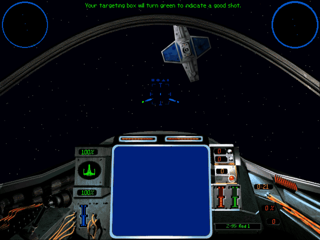
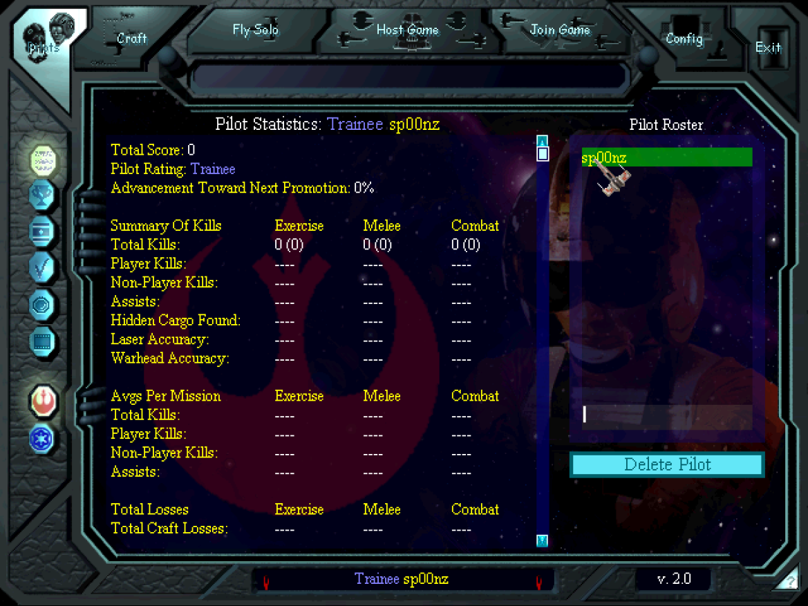
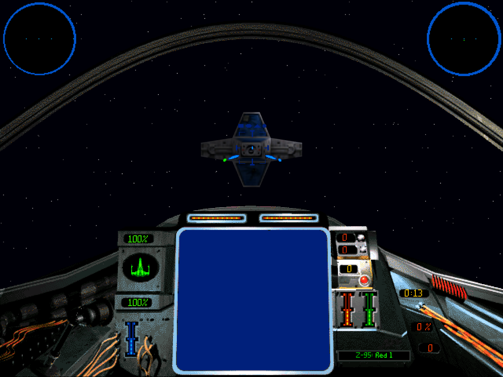
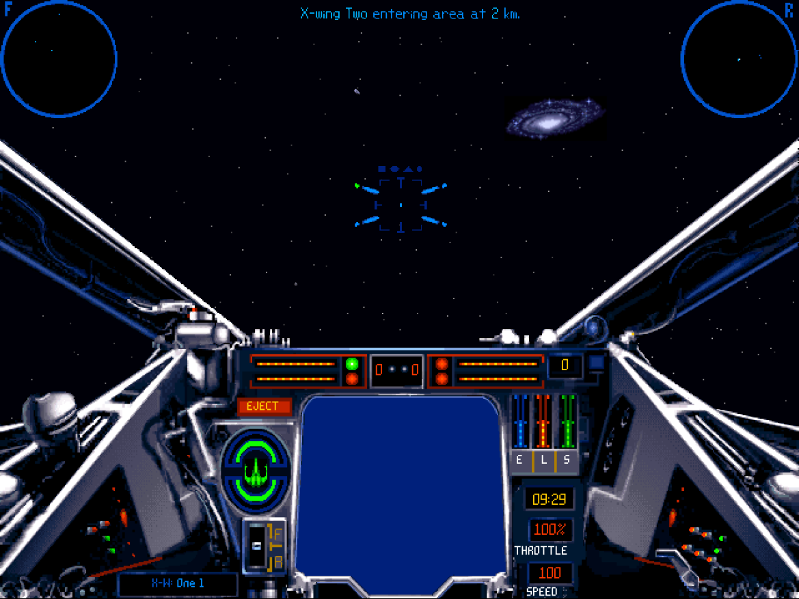
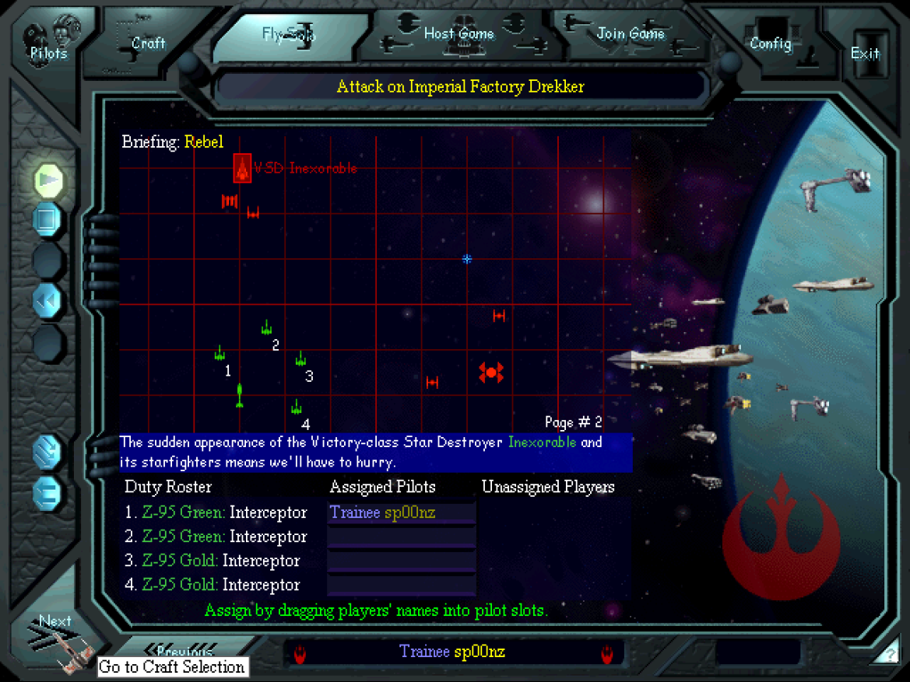
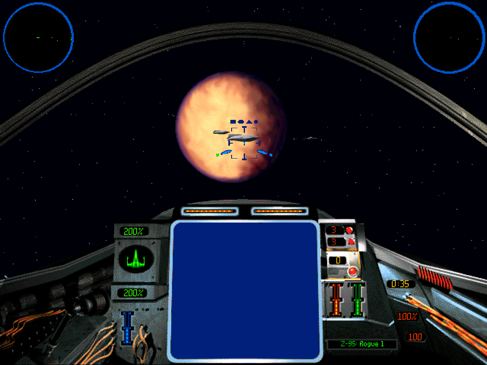
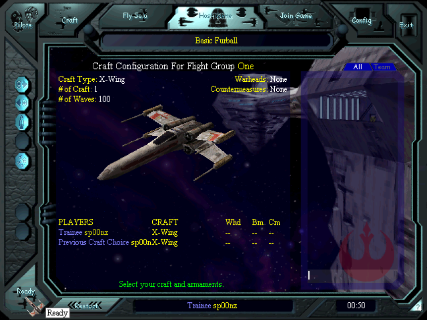
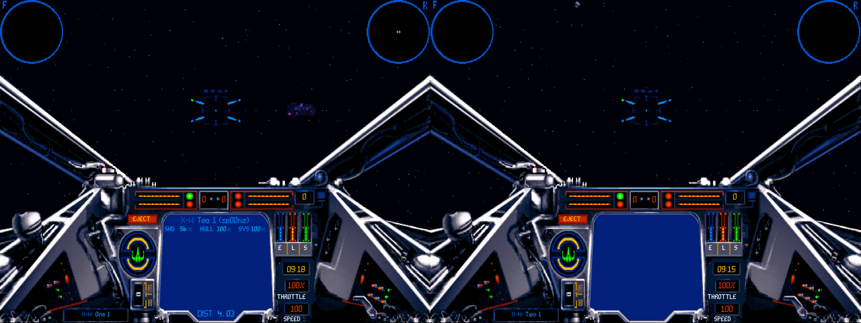

# X-Wing vs TIE Fighter recomp

A static recompilation of **Star Wars: X-Wing vs TIE Fighter** (1.10, the
Windows 95 game as sold on Steam) and its expansion **Balance of Power** (2.0)
to native 32-bit Windows programs, with the remaster of the
[X-Wing](https://github.com/sp00nznet/xwing-recomp) and
[TIE Fighter](https://github.com/sp00nznet/tiefighter-recomp) recomps, which
this is a fork of. The game's x86 code is lifted to C by
[pcrecomp](https://github.com/sp00nznet/pcrecomp) and runs on its native32
runtime.



You supply your own copy of the game. Nothing from it is in this repo.

## Status

**Alpha.** Both games fly.

- **X-Wing vs TIE Fighter** (`xvtrecomp.exe`): boots, plays the intro movie
  and the credits, runs the front end (pilot roster, Fly Solo, Training
  Exercises, briefing, craft selection) and flies Training mission 1, Gunnery
  Training, in the Z-95 Headhunter's cockpit. Every single-player mode
  reaches flight: Training, Melee, Tournament, Combat Engagements and Battles.
- **Balance of Power** (`boprecomp.exe`): the expansion is its own build of
  the game, in its own folder, lifted separately (4993 functions, no errors).
  It runs the v2.0 front end, plays its Smacker movies and flies the same
  training mission, and its Campaigns mode plays the opening crawl of
  Spreading the Rebellion and flies its first mission.

Both draw the game's 3D hardware mode with Direct3D 11 at the window's
resolution.

**Multiplayer works between two machines**: one hosts, the other joins by IP
address (Config screen, or `ipaddress` in `Config.cfg`), both meet in the
lobby, pick craft, and fly the same Melee. Tested between two Windows VMs on
the LAN. Not yet checked: missions flown to the end, more than two players,
Balance of Power online.










## The remaster

Carried over from X-Wing and TIE Fighter, in both hosts. The settings menu is
F10 (or right-click beside the picture), kept in `build\xvt.ini`:

| What | How |
|---|---|
| **Its own window** | Direct3D 11, resizable; F11 or Alt+Enter for borderless fullscreen. With no GPU (a VM, RDP) it falls back to WARP. |
| **Scaling** (F12) | sharp-bilinear (default), smooth, CRT, nearest or integer scaling for the 640x480 art (menus, movies, the cockpit). |
| **High-resolution 3D** | the game's 3D hardware mode, switched on at start, drawn at the window's resolution with MSAA. `--software-3d` gives the original renderer. |
| **HD textures** | `mods\textures\<hash>.png` replaces a texture the game uploads; `--dump-textures` writes the originals to `mods\dump\`. |
| **Mod files** | a file under `mods\files\` replaces the game's file at the same path, without changing the game's copy. |
| **Flying without a joystick** | an Xbox pad, the mouse in flight, or the arrow keys. A real joystick is used when one is plugged in. |

Checked in both games with scripted runs: high-resolution 3D, CRT scaling,
HD texture replacement and dumping, mod files, the virtual stick, and sound
(effects through DirectSound, music through WIN32.dll). A real Xbox pad and
mouse flying use the same code as X-Wing but have not been tried in XvT.

## Step by step

1. Copy the Steam folder `STAR WARS X-Wing vs TIE Fighter` into `game/`.
2. Unwrap the SteamStub DRM from both executables with
   [Steamless](https://github.com/atom0s/Steamless):
   ```
   Steamless.CLI.exe game\z_xvt__.exe
   move game\z_xvt__.exe.unpacked.exe work\xvt.exe
   Steamless.CLI.exe game\BalanceOfPower\z_xvt__.exe
   move game\BalanceOfPower\z_xvt__.exe.unpacked.exe work\bop.exe
   ```
3. Catalogue and lift them:
   ```
   py -3 ..\pcrecomp\tools\disasm\disasm32.py work\xvt.exe -o work\functions.json
   py -3 run_lift.py --all
   py -3 ..\pcrecomp\tools\disasm\disasm32.py work\bop.exe -o work\bop_functions.json
   py -3 run_lift.py --all --bop
   ```
   Balance of Power is optional: without `src\recomp\gen_bop` only
   `xvtrecomp.exe` is built.
4. Build: `build.cmd` (Visual Studio 2022, x86 tools).
5. Run: `build\xvtrecomp.exe --run`, or `build\boprecomp.exe --run` for
   Balance of Power.

## How it differs from the original

Everything in TIE Fighter's table, and:

| What | Why |
|---|---|
| The CD-music calls go to the Steam edition's `WIN32.dll` | X-Wing and TIE ship the same thing as `MUSIC.dll` |
| Writes to the front buffer of a flip chain are presented | the movie player and front end draw there, which a real card shows at once |
| The 3D hardware mode is switched on at start | `use_3d_hardware1`/`2` and `bilinear1`/`2` in `Config.cfg` (Balance of Power: `config2.cfg`), and a `video.cfg` naming the card, which the launcher would write; F10 switches back to software |
| A frame the game does not clear starts cleared, depth at the far plane | XvT never clears through the viewport, as a card of the day began each frame cleared. The far plane follows the game's depth test: 1.0 for 1.1's LESS, 0.0 for Balance of Power's GREATER |
| `SuspendThread` keeps the machine lock | the movie player suspends its decoder thread around every frame; called unlocked, it could catch that thread holding the lock, and the intro hung on its first frame |
| The music DLL is called by one thread at a time | `WIN32.dll` is not thread-safe; two game threads meeting in it corrupted the heap about one run in four |
| DirectPlay is the host's own (`src/runtime/dplay.c`), over TCP port 47700 | Windows' DirectPlay no longer finds sessions between machines (its helper takes the request and never answers), and needs an optional Windows feature. The host provides what XvT uses: the lobby's Connect, players and groups, Send and Receive. The host machine needs port 47700 open |
| Balance of Power runs in `game\BalanceOfPower` | the Steam launcher starts its executable there; it reads its own `config2.cfg`, `video.cfg` and data |

## Test switches

As in X-Wing: `--keys` scripts keys, clicks (`click:X:Y`, game pixels), the
virtual joystick (`N:stick:X:Y`, `N:fire`), `on:NAME` waits for the game to
open a file, and `N:shot=file.png` takes a screenshot of the game's own frame.
`press:X:Y` and `release:X:Y` make a drag. `--watchdog S` ends a run after S seconds; test runs are muted unless
`--sound`. `docs/flight_script.txt` is the script from the pilot roster to
Gunnery Training, and works in both hosts.

## License

MIT for the code here (LICENSE); the game is © Lucasfilm / LucasArts / Totally Games.
