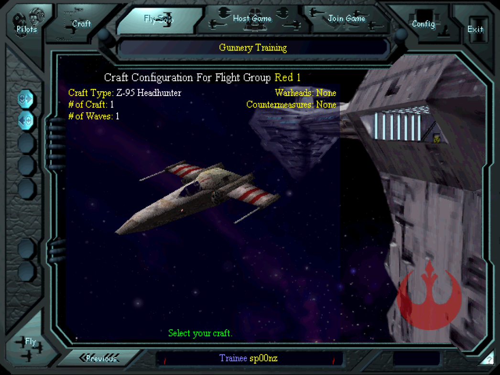

# X-Wing vs TIE Fighter recomp

A static recompilation of **Star Wars: X-Wing vs TIE Fighter** (1.10, the
Windows 95 game as sold on Steam) to a native 32-bit Windows program, with the
remaster of the [X-Wing](https://github.com/sp00nznet/xwing-recomp) and
[TIE Fighter](https://github.com/sp00nznet/tiefighter-recomp) recomps, which
this is a fork of. The game's x86 code is lifted to C by
[pcrecomp](https://github.com/sp00nznet/pcrecomp) and runs on its native32
runtime.

You supply your own copy of the game. Nothing from it is in this repo.

## Status

**Alpha.** Flies. Boots, plays the intro movie and the credits, runs the
front end (pilot roster, Fly Solo, Training Exercises, briefing, craft
selection) and flies Training mission 1, Gunnery Training, in the Z-95
Headhunter's cockpit, in the game's 3D hardware mode drawn by Direct3D 11 at
the window's resolution.




## Step by step

1. Copy the Steam folder `STAR WARS X-Wing vs TIE Fighter` into `game/`.
2. Unwrap the SteamStub DRM from your copy with
   [Steamless](https://github.com/atom0s/Steamless):
   ```
   Steamless.CLI.exe game\z_xvt__.exe
   move game\z_xvt__.exe.unpacked.exe work\xvt.exe
   ```
3. Catalogue and lift it:
   ```
   py -3 ..\pcrecomp\tools\disasm\disasm32.py work\xvt.exe -o work\functions.json
   py -3 run_lift.py --all
   ```
4. Build: `build.cmd` (Visual Studio 2022, x86 tools).
5. Run: `build\xvtrecomp.exe --run`

## How it differs from the original

Everything in TIE Fighter's table, and:

| What | Why |
|---|---|
| The CD-music calls go to the Steam edition's `WIN32.dll` | X-Wing and TIE ship the same thing as `MUSIC.dll` |
| Writes to the front buffer of a flip chain are presented | the movie player and front end draw there, which a real card shows at once |
| The 3D hardware mode is switched on at start | `use_3d_hardware1`/`2` and `bilinear1`/`2` in `Config.cfg` (Balance of Power: `config2.cfg`), and a `video.cfg` naming the card, which the launcher would write; F10 switches back to software |
| A frame the game does not clear starts cleared, depth at the far plane | XvT's depth test is LESS and it never clears through the viewport, as a card of the day began each frame cleared |
| `SuspendThread` keeps the machine lock | the movie player suspends its decoder thread around every frame; called unlocked, it could catch that thread holding the lock, and the intro hung on its first frame |

## License

MIT for the code here (LICENSE); the game is © Lucasfilm / LucasArts / Totally Games.
